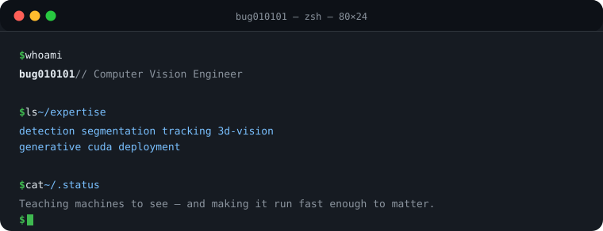

<!-- ================= HEADER ================= -->

  

<!-- ================= CONNECT ================= -->

  
  
  

---

### Arsenal

| | |
|---|---|
| **Languages** |     |
| **Vision** |    |
| **Generative** |    |
| **Inference** |    |
| **Backend** |     |
| **Infra** |     |
| **Tooling** |     |

---

### Stats

  
  

  

  

---

